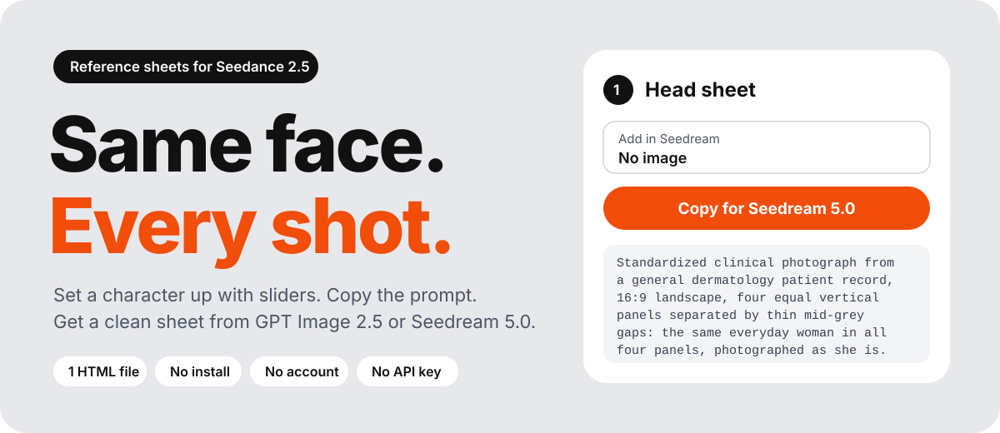
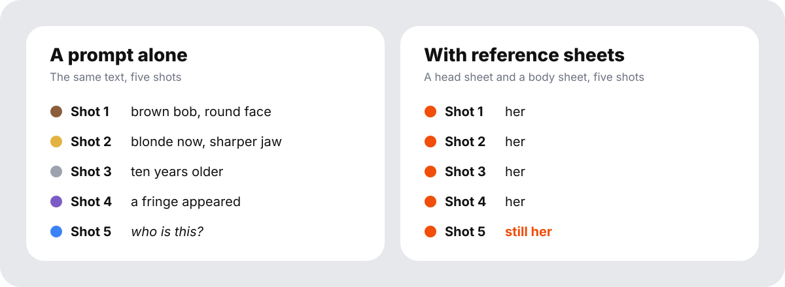
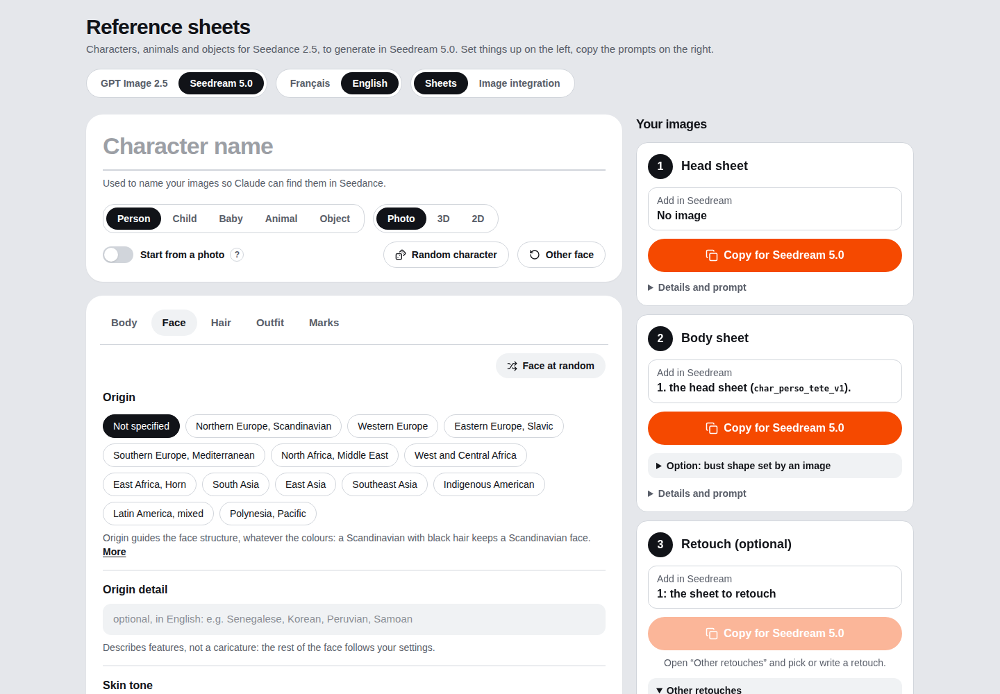

<h1 align="center">Seedance Reference Sheets</h1>

  
  
  
  

  

  <a href="https://mmmprod-org.github.io/seedance-reference-sheets/"><strong>Open the app</strong></a> &middot;
  <a href="https://github.com/MMMProd-Org/seedance-reference-sheets/releases">Download a version</a> &middot;
  <a href="https://github.com/MMMProd-Org/seedance-reference-sheets/issues/new/choose">Report an issue</a>

---

You ask a video model for "a woman in a red coat". Five shots later, you have met five different women.

Seedance 2.5 can hold a character steady, but only from clean references: the same light, a plain grey backdrop, matching views, nothing invented from one view to the next. Writing the prompts for sheets like that is where the hours go.

This app writes them. You move sliders. It writes. She stays herself.

## Before / after

  

A head sheet for the face, a body sheet for the body, both added to Seedance 2.5 as references: every clip starts from the same person.

## How it works

1. **Set it up.** Pick Person, Animal or Object. Adjust face, body, hair, outfit and marks, or leave them on Auto. *Random character* if you have no idea yet.
2. **Copy the prompt.** Each card says which image model it is for and which images to attach.
3. **Generate and reuse.** Make the sheet in GPT Image 2.5 or Seedream 5.0, then add it to Seedance 2.5 as a reference. The suggested file names keep every sheet easy to find.

  

## What's inside

- **One role per image.** For a person, a head sheet for the face and a body sheet for the body. For an animal, one sheet of the whole animal, with optional head close-ups made from it. For an object or a place, one image per view; an object can also have its three views side by side in one image (a triptych). Each reference does one job.
- **People, animals, objects and places.** Vehicles on their wheels, clothing on an invisible mannequin (laid flat for its optional third view; a garment kept exactly as in your photo goes on it only if you tick the option), products shot on their own, and a house exterior or an interior, by day and by night.
- **Fine control where it matters.** Age shown through visible signs, facial structure, skin realism, separate sliders for muscle volume and definition, outfits with wear and dirt, scars and marks pinned to a side and a spot.
- **Edits without drift.** Retouch an approved sheet, dress a body sheet, add the heads, while the proportions stay put.
- **A cast, not just a character.** Name several characters in one GPT Image conversation. Each prompt points to its own character and keeps the others out.
- **Two image models.** Prompts written for GPT Image 2.5 or Seedream 5.0, with a length counter that warns you when a prompt gets long enough for the model to skip parts of it.
- **English or French interface.**
- **Private by design.** Everything runs in your browser. There is no backend, and your settings stay in your browser's local storage. The only outside request is for the fonts.

Each release is the whole app as one HTML file, so any version can be kept and opened offline. The app shows its version in the header.

## Supported models

| Step | Model | Coverage |
| --- | --- | --- |
| Reference sheets | GPT Image 2.5 | People, animals, objects, places |
| Reference sheets | Seedream 5.0 | People (photo style), animals, objects, places |
| Video | Seedance 2.5 | Uses the sheets as image references |

## What works, written down

Every prompt change and what the real renders showed (works, does not work, still to test) goes into [docs/PROMPT-LOG.md](docs/PROMPT-LOG.md). Nothing that failed is tried again without a new reason. The models never remember. The log does.

## FAQ

**Does it generate the images?**
No. It writes the prompts. You generate the sheets in GPT Image 2.5 or Seedream 5.0 with your own account. One job, done properly.

**Will Seedance accept my sheets?**
That depends on where you run Seedance. Some services restrict reference images that show realistic human faces. Check your platform's rules. If a model update breaks your results, open a *Model compatibility* issue.

**Does it need a server?**
No. It is one web page. Download a release and it opens from your disk.

**Does it work on my cat?**
Yes. Animals get a sheet of the whole animal, plus head close-ups made from it if you want them. The cat will not thank you.

## Responsible use

Use photos of real people only with their consent.
Do not use this tool to make sexual, deceptive or harassing content about real people.
Follow the rules of OpenAI, ByteDance and every platform you generate on.

## Issues and feedback

- [Bug report](https://github.com/MMMProd-Org/seedance-reference-sheets/issues/new?template=bug_report.yml): something in the app is broken.
- [Model compatibility](https://github.com/MMMProd-Org/seedance-reference-sheets/issues/new?template=model_compat.yml): a model update changed the results, or a prompt is now refused. Models change often, and these reports are what keep the prompts current.
- [Feature request](https://github.com/MMMProd-Org/seedance-reference-sheets/issues/new?template=feature_request.yml): a new kind of sheet or control.

## Build it yourself

One Python 3 command, no dependencies. See [docs/BUILD.md](docs/BUILD.md).

## License

[PolyForm Noncommercial 1.0.0](LICENSE): free for personal, research and other noncommercial use.
For commercial use, open an issue to ask about a license.

Seedance and Seedream are trademarks of ByteDance. GPT Image is a trademark of OpenAI.
This project is independent and is not affiliated with or endorsed by either company.
