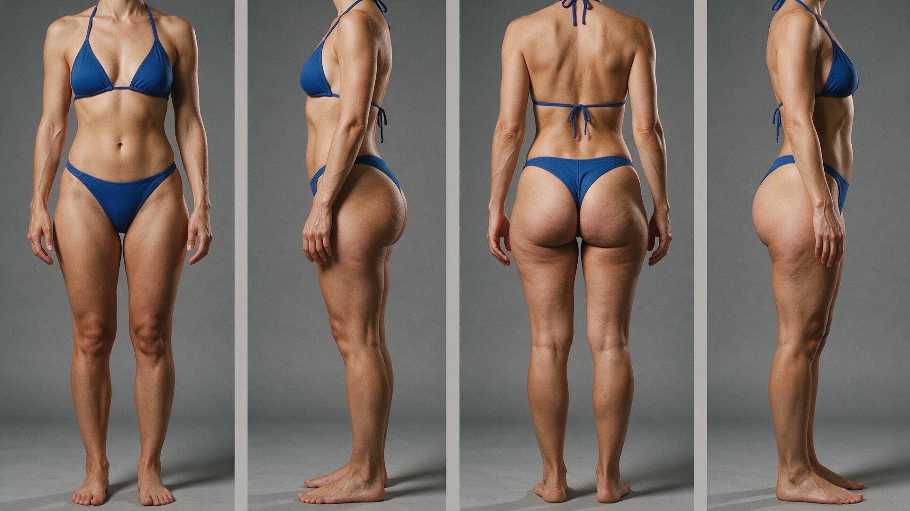

<h1 align="center">Seedance Reference Sheets</h1>

<strong>Create characters who feel real.</strong>

  
  
  
  

  <a href="https://mmmprod-org.github.io/seedance-reference-sheets/"><strong>Create your character</strong></a> &middot;
  <a href="https://github.com/MMMProd-Org/seedance-reference-sheets/releases">Download a version</a> &middot;
  <a href="https://github.com/MMMProd-Org/seedance-reference-sheets/issues/new/choose">Report an issue</a>

---

If your AI portraits keep coming back with flawless skin and a model-perfect face, give the model a more individual person to work with.

**Seedance Reference Sheets helps you describe characters who feel real:** visible age, skin texture, facial proportions, natural asymmetry and distinctive marks. The aim is a person you could imagine meeting, with an appearance you choose.

One HTML file turns your settings into ready-to-copy prompts for GPT Image 2.5 or Seedream 5.0. You generate the images in your chosen model, then use the sheets as references in Seedance 2.5.

  

<strong>Body realism, down to the details.</strong> 
Example generated with <strong>Seedream 5.0</strong>. Look at the skin texture, natural folds and subtle variations in tone.

## Realism starts with the details

- **Choose how idealised the face should be.** The Beauty control includes everyday and unconventional faces alongside more idealised looks.
- **Give skin its texture.** Use the skin realism settings to ask for fine pores, uneven tone, small blemishes, redness or under-eye shadows.
- **Make age visible.** Age is described through facial and skin cues, from youthful features to expression lines and wrinkles.
- **Add individual features.** Shape facial proportions and describe freckles, scars or other marks, including their side and location.
- **Shape the whole person.** Adjust body build and proportions, with separate controls for muscle volume and definition.

These controls guide the image model. Check each generated sheet for the traits you asked for before using it as a reference.

## Before / after

  

Once you have designed the character, the next challenge is keeping them recognisable from shot to shot. Matching references give your video model a consistent starting point.

  

A head sheet for the face, a body sheet for the body: give each clip the same character references in Seedance 2.5.

## How it works

1. **Set it up.** Pick Person, Child, Baby, Animal or Object. Adjust the available controls or leave them on Auto. *Random character* if you have no idea yet.
2. **Copy the prompt.** Each card says which image model it is for and which images to attach.
3. **Generate and reuse.** Make the sheet in GPT Image 2.5 or Seedream 5.0, then add it to Seedance 2.5 as a reference. The suggested file names keep every sheet easy to find.

  

## What's inside

- **One role per image.** For a person, a head sheet for the face and a body sheet for the body. For an animal, one sheet of the whole animal, with optional head close-ups made from it. For an object or a place, one image per view; an object can also have its three views side by side in one image (a triptych). Each reference does one job.
- **People, animals, objects and places.** Cars on their wheels, boats on a cradle, aircraft on the ground, other vehicles staged by their kind; clothing on an invisible mannequin (laid flat for its optional third view; a garment kept exactly as in your photo goes on it only if you tick the option), products shot on their own, and a house exterior or an interior, by day and by night.
- **Children and babies.** Separate, dressed reference prompts: head and body for children aged 3–12, one sheet for a nine-month-old baby. Adult body settings stay out of these modes.
- **Choose the clothes from a photo.** Keep the photo's clothes, or use the Outfit tab for both the head and body sheets. Existing saved outfits are preserved. Sheet layout only keeps the whole photo as it is.
- **Describe an outfit once.** Use one text for clothes and accessories on both sheets and the own-outfit retouch. Switching it off restores your individual garment choices.
- **Face character.** Rugged, Menacing, Kind or Angelic guides traits left on Auto, while your manual choices and Beauty keep priority. Available for adults without a source photo.
- **Choose your views.** Pick 1–4 separate views for an object or place. Existing saves keep their usual views; the object triptych remains available. Houses also have a plain grey floor and backdrop option.
- **Fine control where it matters.** Age shown through visible signs, facial structure, skin realism, separate sliders for muscle volume and definition, outfits with wear and dirt, scars and marks pinned to a side and a spot.
- **Edits that preserve the reference.** Choose an applicable retouch for an approved sheet, dress it in the outfit you choose, or combine head and body. Editing a preset keeps its operation and images. The mobile Retouch button opens help when no change is set. Prompts ask to preserve proportions; check the generated result.
- **Image integration.** Prepare a prompt to insert an asset into a still photo, matching its camera, light, shadows and texture. Add the two images in your image generator.
- **A cast, not just a character.** Name several characters in one GPT Image conversation. Each prompt points to its own character and keeps the others out.
- **Two image models.** Prompts written for GPT Image 2.5 or Seedream 5.0, with a length counter that warns you when a prompt gets long enough for the model to skip parts of it.
- **English or French interface.**
- **Private by design.** Everything runs in your browser. There is no backend, and your settings stay in your browser's local storage. The only outside request is for the fonts.

Each release is the whole app as one HTML file, so any version can be kept and opened offline. The app shows its version in the header.

## Supported models

| Step | Model | Coverage |
| --- | --- | --- |
| Reference sheets | GPT Image 2.5 | Adults, children, babies, animals, objects, places |
| Reference sheets | Seedream 5.0 | Adults, children and babies in photo, 3D and 2D styles; adults from a source photo; animals, objects, places |
| Still image integration | GPT Image 2.5 / Seedream 5.0 | Compositing prompt for a base photo and an asset |
| Video | Seedance 2.5 | Uses the sheets as image references |

For a person from a photo or in 3D/2D, select Seedream explicitly: the automatic model choice stays the same.
The new person prompts adapt the existing GPT wording to Seedream's image references. Their generated images
remain to be tested; longer prompts keep the visible length warning.

## What works, written down

Every prompt change and what the real renders showed (works, does not work, still to test) goes into [docs/PROMPT-LOG.md](docs/PROMPT-LOG.md). Nothing that failed is tried again without a new reason. The models never remember. The log does.

## FAQ

**Does it generate the images?**
No. It writes the prompts. You generate the sheets in GPT Image 2.5 or Seedream 5.0 with your own account. One job, done properly.

**Will Seedance accept my sheets?**
That depends on where you run Seedance. Some services restrict reference images that show realistic human faces. Check your platform's rules. If a model update breaks your results, open a *Model compatibility* issue.

**Does it need a server?**
No. It is one web page. Download a release and it opens from your disk.

**Does it work on my cat?**
Yes. Animals get a sheet of the whole animal, plus head close-ups made from it if you want them. The cat will not thank you.

## Responsible use

Use photos of real people only with their consent.
Do not use this tool to make sexual, deceptive or harassing content about real people.
Follow the rules of OpenAI, ByteDance and every platform you generate on.

## Issues and feedback

- [Bug report](https://github.com/MMMProd-Org/seedance-reference-sheets/issues/new?template=bug_report.yml): something in the app is broken.
- [Model compatibility](https://github.com/MMMProd-Org/seedance-reference-sheets/issues/new?template=model_compat.yml): a model update changed the results, or a prompt is now refused. Models change often, and these reports are what keep the prompts current.
- [Feature request](https://github.com/MMMProd-Org/seedance-reference-sheets/issues/new?template=feature_request.yml): a new kind of sheet or control.

## Build it yourself

One Python 3 command, no dependencies. See [docs/BUILD.md](docs/BUILD.md).

## License

[PolyForm Noncommercial 1.0.0](LICENSE): free for personal, research and other noncommercial use.
For commercial use, open an issue to ask about a license.

Seedance and Seedream are trademarks of ByteDance. GPT Image is a trademark of OpenAI.
This project is independent and is not affiliated with or endorsed by either company.
